# ⚡ AgentFlow: Autonomous Private AI Work Assistant

> *"A free, private AI assistant that does your repetitive digital work, shows how it thinks, and asks permission before it acts."*

[-cyan)](https://ollama.ai)
[](#zero-cost-philosophy)
[](https://fastapi.tiangolo.com)
[](https://langchain-ai.github.io/langgraph/)
[](https://vitejs.dev)
[](https://www.docker.com)
[](#for-students-job-seekers--businesses-in-india)

---

## 🌟 Pitch & Vision

Most AI tools are expensive subscription traps ($20–$100/mo), leak private documents to cloud servers, and execute hidden actions without transparency.

**AgentFlow** turns your own computer into a tireless, transparent, private digital assistant:
1. **100% Free & Local**: Powered entirely by local open-weight LLMs via **Ollama** (Llama 3.1, Qwen 2.5). Zero API keys, zero monthly fees.
2. **Shows How It Thinks**: Real-time **Live Agent Brain** timeline streaming each cognitive step over Server-Sent Events (SSE). Active reasoning steps glow in neon cyan.
3. **Asks Permission Before It Acts**: Strict **Human-in-the-Loop** safety cards for high-stakes actions (sending emails, overwriting files). The agent pauses safely until you click **Approve** or **Reject**.
4. **Autonomous Background Worker**: Runs recurring scheduled tasks (e.g. *"Every morning at 8:00 AM IST, email me top AI news"*) via **APScheduler**.

---

## 🎯 Designed for Students, Job Seekers & Businesses in India

- **Students**: Upload research papers and lecture notes (PDF/TXT) to `workspace/` and get instant executive summaries and study checklists.
- **Job Seekers**: Speak via browser microphone in **English, Hindi (हिन्दी), or Urdu (اردو)** to research open roles in Bengaluru or Gurugram, draft customized outreach emails, and generate portfolio materials.
- **Small Business Owners & Freelancers**: Draft bilingual contracts, calculate costs in Indian Rupees (₹), audit invoices, and save files locally without data ever leaving your device.

---

## 🏗️ Architecture Diagram

```mermaid
flowchart TD
    subgraph UI ["Client Layer (React 18 + Vite + Tailwind + Framer Motion)"]
        TaskBox["Task Box (Web Speech API Voice: EN / HI / UR)"]
        Brain["Live Agent Brain (Glowing Cognitive Graph)"]
        WorkflowUI["Workflow Engine (Visual DAG Step Graph)"]
        NewsUI["AI News & Telegram Digest View"]
        ReportsUI["Executive Reports & CSV/Excel Studio"]
        MonitorsUI["Website Uptime & Latency Monitors"]
        IntegrationsUI["Integrations Hub & Template Gallery"]
        Approval["Human-in-the-Loop Modal (Approve / Reject)"]
        Schedules["Schedules Manager (APScheduler UI)"]
        Dashboard["ROI Dashboard (Recharts Area/Pie/Metrics)"]
    end

    subgraph Backend ["FastAPI Application (Async Python 3.11)"]
        SSE["Server-Sent Events (SSE Stream)"]
        REST["REST API Endpoints"]
        WorkflowEngine["Prompt-to-Workflow Engine (DAG Runner)"]
        SchedulerService["APScheduler (Asia/Kolkata Persistent Cron)"]
        MonitorSentinel["Website Monitor Background Sentinel"]
        IntegrationsService["Connection Health Probes & Templates"]
    end

    subgraph Storage ["Local SQLite Database (agentflow.db)"]
        DBTasks["tasks & task_steps"]
        DBWorkflows["workflows & workflow_runs"]
        DBSched["schedules"]
        DBMonitors["monitors & monitor_logs"]
        DBPrefs["user_settings (Long-Term Memory)"]
        DBAppr["approvals"]
    end

    subgraph AgentCore ["Autonomous LangGraph ReAct Engine"]
        Agent["LangGraph Agent (create_react_agent)"]
        SystemPrompt["System Prompt + Injected User Memory + Real Date"]
    end

    subgraph LLM ["Local Inference (Ollama)"]
        OllamaLLM["Local Ollama Server (Llama 3.1 / Qwen 2.5)"]
    end

    subgraph Tools ["10 Sandboxed Registered Tools"]
        T1["get_datetime (IST Real-Time)"]
        T2["web_search (DuckDuckGo Parallel)"]
        T3["fetch_page (Trafilatura Web Extractor)"]
        T4["save_file (Sandboxed to workspace/)"]
        T5["read_file (TXT, PDF, CSV)"]
        T6["list_files (Workspace Directory Audit)"]
        T7["send_email (Gmail SMTP / Safe Simulation)"]
        T8["send_telegram_message (Telegram Bot API / Safe Simulation)"]
        T9["analyze_tabular_data (Auto-Clean, KPIs, Recharts, Excel)"]
        T10["check_website_health (HTTP Latency, Uptime & Status)"]
    end

    TaskBox -->|POST /api/tasks| REST
    WorkflowUI -->|POST /api/workflows/plan| REST
    REST --> SSE
    SSE --> Brain
    REST <--> AgentCore
    REST <--> WorkflowEngine
    WorkflowEngine --> Tools
    AgentCore --> Agent
    Agent <--> OllamaLLM
    Agent --> Tools
    Tools -.->|Intercept Dangerous Action| Approval
    SchedulerService -->|Trigger Job| WorkflowEngine
    MonitorSentinel -->|15-Min Check| T10
    Backend <--> Storage
    Dashboard <-->|GET /api/stats| REST
```



---

## ✨ Full Suite of Autonomous Capabilities (Stages 0 – 6)

| # | Module / Feature | Description |
|---|---|---|
| 0 | **Multi-Lingual Voice Input** | Browser Web Speech API with explicit permission handling, visual listening animation, supporting English (India), Hindi (हिन्दी), and Urdu (اردو). |
| 1 | **Prompt-to-Workflow Engine** | Natural language to validated multi-step DAG plan using only registered tools. Interactive visual step graph that glows as steps execute, dry-run mode, and credential checks. |
| 2 | **Persistent APScheduler Upgrade** | SQLite-backed jobs with hourly, daily, weekly, and custom cron expressions. Configured for `Asia/Kolkata` (IST) with pause, resume, edit, cancel, and failure alerts. |
| 3 | **AI News & Telegram Digest** | Multi-source RSS (Google News, arXiv) with title deduplication (Jaccard similarity). Auto-generates structured daily summaries and sends via Telegram Bot with approval gates. |
| 4 | **CSV & Excel Executive Studio** | Automated data cleaning, KPI extraction (Revenue, Margin %, CAC, etc.), Recharts visual formatting, AI executive summaries, and multi-sheet downloadable `.xlsx` reports via `openpyxl`. |
| 5 | **Website & API Uptime Sentinel** | Monitored website health checks (latency in ms, status codes), repeated-failure incident detection, automated Telegram emergency alerts, and background sentinel runner. |
| 6 | **Integrations Hub & Templates Gallery** | Live connection test probes for Ollama, Telegram, Gmail, DuckDuckGo, News, and Workspace. Gallery of 6 one-click workflow templates customized for Indian SMBs, students, and freelancers. |
| 7 | **Live Agent Brain (XAI)** | Animated glowing cognitive timeline: *Thinking* ➔ *Tool Call* ➔ *Tool Result* ➔ *Final Answer*. |
| 8 | **Human-in-the-Loop Safety** | Strictly pauses execution before dispatching emails, Telegram messages, or overwriting files, rendering interactive Approve/Reject cards. |
| 9 | **Interactive ROI Dashboard** | Recharts visualizations: tasks run, success rate %, tool usage breakdown, and estimated hours saved in INR (₹). |
| 10 | **Zero-Cost & 100% Private** | Powered entirely by local Ollama models and local SQLite storage. Zero paid third-party API dependencies. |

---

## 🛠️ Tech Stack

- **Large Language Model**: [Ollama](https://ollama.ai) (`llama3.1` or `qwen3:4b`), running locally with zero API cost.
- **Agent Orchestrator**: [LangGraph](https://github.com/langchain-ai/langgraph) `create_react_agent` with [LangChain](https://python.langchain.com/).
- **Backend API**: [FastAPI](https://fastapi.tiangolo.com/), `uvicorn`, [APScheduler](https://apscheduler.readthedocs.io/), `aiosqlite`, `python-multipart`.
- **Frontend SPA**: React 18, [Vite](https://vitejs.dev), [Tailwind CSS](https://tailwindcss.com), [Framer Motion](https://www.framer.com/motion/), [Recharts](https://recharts.org), [Lucide React](https://lucide.dev).
- **Deployment**: [Docker Compose](https://docs.docker.com/compose/) and unified single-port FastAPI serving.

---

## 🚀 Quick Start Guide

### Prerequisites
1. **Ollama**: Download and install from [ollama.com](https://ollama.com).
2. Pull your preferred model (e.g., Llama 3.1 or Qwen):
   ```bash
   ollama pull llama3.1
   # OR for fast lightweight laptop execution:
   ollama pull qwen3:4b
   ```
3. Ensure Ollama is running (`ollama serve` or Ollama desktop app).

---

### Option A: Local Installation (Recommended for Development)

#### 1. Clone & Set Up Backend Virtual Environment
```bash
# Windows PowerShell
python -m venv .venv
.\.venv\Scripts\Activate.ps1

# Install requirements
pip install -r requirements.txt
```

#### 2. Configure Environment Variables
Copy `.env.example` to `.env`:
```bash
cp .env.example .env
```
*(Optional: Add your Gmail credentials to test live email dispatch)*

#### 3. Build Frontend & Start Unified Server
```bash
# Build React UI
cd frontend
npm install
npm run build
cd ..

# Start FastAPI server on http://127.0.0.1:8000
python -m uvicorn backend.main:app --host 127.0.0.1 --port 8000 --reload
```

Open **[http://127.0.0.1:8000](http://127.0.0.1:8000)** in your browser!

---

### Option B: Docker Compose (One-Command Deployment)

Run the entire application in Docker while seamlessly communicating with Ollama on your host machine:

```bash
docker-compose up --build
```
Access the application at **[http://localhost:8000](http://localhost:8000)**.

---

## 🧪 Automated Verification Test Suite

AgentFlow includes comprehensive verification scripts for all autonomous stages:

```bash
# Stage 1: Prompt-to-Workflow Engine & Tool Registration
python backend/test_workflow_engine.py

# Stage 2: Persistent APScheduler with Asia/Kolkata Timezone & Custom Cron
python backend/test_scheduler_stage2.py

# Stage 4: CSV & Excel Report Engine & KPI Calculations
python backend/test_reports_stage4.py

# Stage 5: Website Uptime & Latency Monitoring Sentinel
python backend/test_monitors_stage5.py

# Stage 6: Integrations Hub Health Probes & Workflow Templates Gallery
python backend/test_stage6.py
```

---

## 💬 Sample Task Prompts

### 🇬🇧 English
- *"Check current date and time in India (IST), fetch latest AI news, and save to workspace/ai_report.txt"*
- *"Analyze workspace/samples/sales_data_india.csv, compute monthly growth and margin %, generate an executive summary, and export an Excel report"*
- *"Check website health for https://httpbin.org/status/200 and notify me if latency exceeds 500ms"*
- *"Draft a professional cold email offering freelance Python/FastAPI services to recruiters and send it to insha@example.com"* *(Triggers approval card)*

### 🇮🇳 Hindi (हिन्दी / Hinglish)
- *"Mujhe sales data analyze karke executive summary workspace/report_hindi.txt me save karo aur IST time check karo"*
- *"Aaj ka time batao aur AI ki taza khabar search karke workspace/khabar.txt me save karo"*

### 🇵🇰 Urdu (اردو)
- *"طلباء کے لیے مصنوعی ذہانت (AI) کے تین اہم ترین استعمالات تلاش کریں اور خلاصہ محفوظ کریں"*

---

## 📂 Project Structure

```
AI_agent_project/
├── backend/
│   ├── main.py                 # FastAPI server, REST routes, SSE live stream & SPA mount
│   ├── agent.py                # LangGraph ReAct engine, prompt builder, memory injection
│   ├── workflows.py            # Prompt-to-Workflow Engine (DAG plan generator & executor)
│   ├── news_module.py          # AI News aggregator (Google News, arXiv, Jaccard dedup)
│   ├── reports.py              # CSV/Excel engine (Auto-cleaning, KPIs, multi-sheet openpyxl)
│   ├── monitors.py             # Website uptime & latency monitor sentinel
│   ├── integrations.py         # Integrations connection probes & templates gallery
│   ├── tools.py                # 10 registered sandboxed tools (search, files, email, news, etc.)
│   ├── db.py                   # Async SQLite database (workflows, schedules, monitors, memory)
│   ├── scheduler.py            # APScheduler persistent async runner (Asia/Kolkata)
│   ├── approvals.py            # Human-in-the-loop thread synchronization
│   ├── requirements.txt        # Backend dependencies
│   ├── test_workflow_engine.py # Stage 1 test
│   ├── test_scheduler_stage2.py# Stage 2 test
│   ├── test_reports_stage4.py  # Stage 4 test
│   ├── test_monitors_stage5.py # Stage 5 test
│   └── test_stage6.py          # Stage 6 test
├── frontend/
│   ├── src/
│   │   ├── components/
│   │   │   ├── Navbar.jsx              # Navigation, LLM health indicator, theme toggle
│   │   │   ├── AgentBrain.jsx          # Live glowing cognitive graph & typing effect
│   │   │   ├── WorkflowGraph.jsx       # Interactive animated SVG step graph (Stage 1)
│   │   │   ├── VoiceInputButton.jsx    # Web Speech API microphone (EN, HI, UR, mic permission)
│   │   │   ├── ApprovalCard.jsx        # Glowing Approve/Reject modal
│   │   │   ├── PlannerChecklist.jsx    # Execution plan progress bar
│   │   │   ├── WorkspaceUpload.jsx     # Document upload & quick-summarize chips
│   │   │   └── ParticleBackground.jsx  # Dark glassmorphism glowing particle canvas
│   │   ├── pages/
│   │   │   ├── TaskPage.jsx            # Main interactive agent task execution
│   │   │   ├── WorkflowsPage.jsx       # Autonomous visual workflow designer & executor
│   │   │   ├── NewsPage.jsx            # AI News reader with Telegram digest
│   │   │   ├── ReportsPage.jsx         # CSV & Excel analytical studio with Recharts
│   │   │   ├── MonitoringPage.jsx      # Website & API uptime monitoring dashboard
│   │   │   ├── HistoryPage.jsx         # SQLite historical task replay & audit
│   │   │   ├── SchedulesPage.jsx       # Autonomous recurring jobs manager
│   │   │   ├── DashboardPage.jsx       # Recharts ROI & analytics visualization
│   │   │   └── SettingsPage.jsx        # Integrations Hub, Templates Gallery & User Memory
│   │   ├── App.jsx                     # Top-level SPA router
│   │   └── main.jsx                    # React entrypoint
│   └── package.json
├── workspace/                  # Sandboxed folder for all agent file operations
│   └── samples/                # Pre-loaded sample CSV datasets (sales, student marks, freelance)
├── agentflow.db                # SQLite database (persisted)
├── Dockerfile                  # Multi-stage production container build
├── docker-compose.yml          # Containerized orchestration
├── .env.example                # Template configuration file
└── README.md                   # Project documentation
```

---

## 🔧 Windows Setup & Troubleshooting Guide

### 1. Local Ollama LLM Setup
- **Download**: Install from [ollama.com](https://ollama.com/download/windows).
- **Run the server**: Ollama runs in the background automatically or via PowerShell:
  ```powershell
  ollama serve
  ```
- **Pull your model**:
  ```powershell
  ollama run llama3.1
  # OR for lightweight 4-bit / 7-bit models:
  ollama run qwen2.5:7b
  ```
- **Verify**: In your browser or terminal, verify `http://localhost:11434/api/tags` returns your downloaded models.

### 2. Gmail SMTP Setup (App Passwords)
AgentFlow uses Gmail SMTP for email actions with Human-in-the-Loop safety approval:
1. Go to your **Google Account** > **Security** > Enable **2-Step Verification**.
2. Visit [https://myaccount.google.com/apppasswords](https://myaccount.google.com/apppasswords).
3. Under "App name", type `AgentFlow` and click **Create**.
4. Copy the generated 16-character password (e.g. `abcd efgh ijkl mnop`).
5. Open your `.env` file and set:
   ```env
   GMAIL_EMAIL=your_email@gmail.com
   GMAIL_APP_PASSWORD=abcdefghijklmnop
   ```
> *Note: If credentials are not configured, AgentFlow automatically executes in **Safe Simulation Mode** so workflows never break.*

### 3. Telegram Bot Setup
For the AI News digest and website uptime emergency alerts:
1. Open Telegram and search for `@BotFather`.
2. Send `/newbot` and follow instructions to name your bot.
3. Copy the **HTTP API Bot Token** provided by BotFather.
4. Start a chat with your new bot and click **Start**.
5. To get your **Chat ID**, message `@userinfobot` or `@RawDataBot` on Telegram.
6. Open `.env` and set:
   ```env
   TELEGRAM_BOT_TOKEN=123456789:ABCdefGhIJKlmNoPQRstuVWXyz
   TELEGRAM_CHAT_ID=123456789
   ```

### 4. Browser Voice Microphone Permissions (Web Speech API)
- The Web Speech API is supported natively in **Google Chrome**, **Microsoft Edge**, and **Brave**.
- **Important**: Modern browsers only enable speech recognition in **Secure Contexts** (`http://localhost`, `http://127.0.0.1`, or HTTPS).
- When prompted, click **Allow** on the browser microphone permission popup.
- To re-enable if blocked: Click the lock/settings icon in the browser address bar > **Site settings** > Set **Microphone** to **Allow**.

### 5. Windows PowerShell Console Encoding
If test scripts display unexpected characters, switch your PowerShell session to UTF-8:
```powershell
chcp 65001
$env:PYTHONIOENCODING="utf-8"
```

---

## 🛡️ Privacy & Security Commitments

1. **Local Sandboxing**: All file creation, editing, and reading operations are strictly restricted to the `workspace/` directory with path traversal detection (`..` sequences rejected).
2. **Zero Cloud Telemetry**: Personal profile data, task history, and prompts are saved locally in `agentflow.db`. No data is uploaded to third-party tracking services.
3. **No Unsanctioned Dispatches**: Emails are never sent automatically. The agent halts on the worker thread, emits an SSE approval card, and only resumes if explicitly approved by the user.

---

## 🏆 Competition Highlights

- **Targeted Utility**: Directly addresses the pain points of millions of students, job seekers, and small businesses in India by saving time and eliminating expensive software subscriptions.
- **Explainable AI (XAI)**: Demystifies AI thinking by rendering the LangGraph cognitive loop live in real-time.
- **Production Engineering**: High-quality async architecture, clean separation of concerns, robust error handling, automated verification test suites, and Docker readiness.

*Built with ❤️ for the AI Agent Hackathon.*
